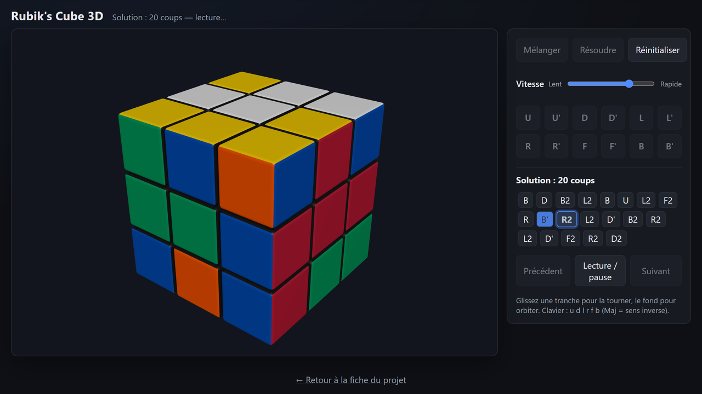

---
# English version of « cube-solver » — text only, shared data lives in fr.md.
# Claude drafts this from Arthur's French, Arthur reviews.
title: "3D Rubik's Cube"
summary: "A 3D Rubik's Cube in your browser: turn it by hand, scramble it, and watch it solve itself, move by move."
coverAlt: "A scrambled 3D Rubik's Cube in dark mode, next to the demo's scramble, solve and reset buttons."
aiNote: 'Built by directing an AI: I framed the work, tested everything and made the calls; it wrote most of the code.'
disclaimer: "Unofficial personal project, not affiliated with Rubik's Brand Ltd or Spin Master; “Rubik's Cube” refers here to the puzzle."
---

## The idea

Everyone knows what a Rubik's Cube is. That made it the perfect first
demo: an object you want to play with, some 3D, and a real algorithmic
problem to solve properly underneath.

## What it does

A 3×3 Rubik's Cube in 3D, in the browser: orbit around the cube, grab a
slice with the mouse or a finger to turn it (it snaps to the nearest
quarter turn), or play with the keyboard and the notation buttons
(U, U', D… B'). One button scrambles the cube (25 animated moves),
another solves it on its own: the solution shows up in notation and
plays move by move or continuously, at an adjustable speed. The cube's
state is remembered between visits.

## Under the hood

Solving uses Kociemba's two-phase algorithm, implemented from scratch:
cubie model, phase coordinates, pruning tables and IDA* search. The
computation runs in a Web Worker so the animation never freezes —
solutions are about 20 moves and come back in a few tens of
milliseconds. The 3D rendering is done with three.js (bundled at build
time, no external request); in the project repo, a Node harness
(`npm run verify`) replays 200 random scrambles and checks every
solution.

## What I learned or decided

The structural choice: a solver written from scratch rather than an
off-the-shelf library — that was the whole point of the project. The
computation goes into a Web Worker so the animation never freezes, and
the 200-scramble harness exists because a solver that looks right can
quietly be wrong. The rest was decided by testing: edge cases (a one-
or two-move scramble, clicking Solve while a move is still in flight),
a page that must survive without WebGL or storage, and controls that
work from the keyboard.

## Known limits

Middle slices don't turn: dragging the middle orbits the camera — the
trade-off I settled on (no M, E or S notation here). Solutions are
around twenty moves — two-phase is fast but not necessarily optimal.
And three.js has a cost: about 570 KB of JavaScript for a demo, the
price of 3D rendering.
