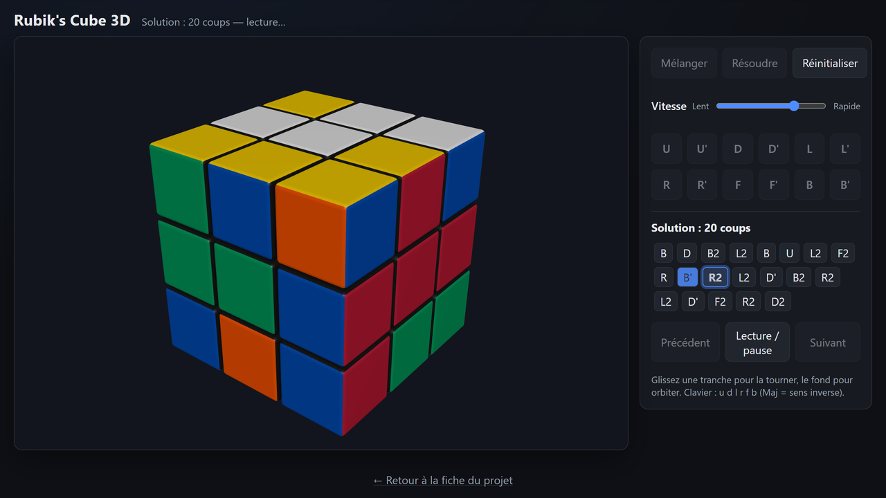

---
# Fiche projet « cube-solver » — le français fait foi. Les données partagées
# (date, stack, liens, image) vivent ici ; en.md ne contient que le
# texte anglais. Champs commentés = optionnels.
title: "Rubik's Cube 3D"
summary: "Un Rubik's Cube en 3D dans le navigateur : on le tourne à la main, on le mélange, et il se résout tout seul, coup par coup."
date: 2026-11-21
status: done # wip | done | archived
kind: web # web | game | desktop | mod | tool
stack:
  - JavaScript
  - three.js
  - Vite
demo: internal # la démo vit dans demos/cube-solver/
links:
  repo: 'https://github.com/Arthur-Lecomte/CubeSolver'
cover: ./cover.png
coverAlt: "Un Rubik's Cube 3D mélangé, en mode sombre, à côté des boutons Mélanger, Résoudre et Réinitialiser de la démo."
featured: false
draft: false # publié le 2026-11-22 sur décision d'Arthur
thirdParty:
  - name: three.js
    license: MIT
    url: 'https://github.com/mrdoob/three.js'
aiNote: "Projet réalisé en dirigeant une IA : j'ai cadré, testé et tranché ; elle a écrit le gros du code."
disclaimer: "Projet personnel non officiel, sans lien avec Rubik's Brand Ltd ni Spin Master ; « Rubik's Cube » désigne ici le casse-tête."
---

## L'idée

Le Rubik's Cube, tout le monde voit ce que c'est. C'était le candidat
idéal pour une première démo : un objet qu'on a envie de manipuler, de la
3D, et derrière, un vrai problème d'algorithmique à résoudre proprement.

## Ce que ça fait

Un Rubik's Cube 3×3 en 3D dans le navigateur : on orbite autour du cube,
on attrape une tranche à la souris ou au doigt pour la tourner (elle se
recale au quart de tour le plus proche), ou on joue au clavier et aux
boutons de notation (U, U', D… B'). Un bouton mélange le cube (25 coups
animés), un autre le résout tout seul : la solution s'affiche en notation,
se lit coup par coup ou en continu, avec une vitesse réglable. L'état du
cube est retenu d'une visite à l'autre.

## Sous le capot

La résolution utilise l'algorithme two-phase de Kociemba, implémenté from
scratch : modèle en cubies, coordonnées de phase, tables de pruning et
recherche IDA*. Le calcul tourne dans un Web Worker pour ne jamais figer
l'animation — les solutions font environ 20 coups et tombent en quelques
dizaines de millisecondes. Le rendu 3D est fait avec three.js (embarqué
au build, aucune requête externe) ; dans le repo du projet, un harnais
Node (`npm run verify`) rejoue 200 mélanges aléatoires et contrôle
chaque solution.

## Ce que j'ai appris ou décidé

Le choix structurant : un solveur écrit from scratch plutôt qu'une
bibliothèque toute faite — c'était tout l'intérêt du projet. Le calcul
part dans un Web Worker pour que l'animation ne gèle jamais, et le
harnais de 200 mélanges existe parce qu'un solveur qui a l'air juste
peut très bien se tromper en silence. Le reste s'est décidé en testant :
les cas limites (un mélange à un ou deux coups, un clic sur Résoudre
pendant qu'un coup est encore en vol), la page qui doit survivre sans
WebGL et sans stockage, et des contrôles utilisables au clavier.

## Limites connues

Les tranches du milieu ne se tournent pas : glisser au centre fait
orbiter la caméra, c'est le compromis retenu (pas de notation M, E ou S
ici). Les solutions font une vingtaine de coups — le two-phase est
rapide mais pas forcément optimal. Et three.js se paie : environ 570 Ko
de JavaScript pour une démo, c'est le prix du rendu 3D.
